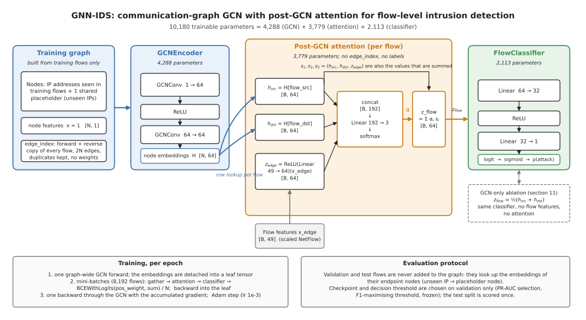

# GNN-IDS — Graph Neural Network Intrusion Detection on NetFlow data

A communication-graph GNN for flow-level network intrusion detection, evaluated on
**NF-UNSW-NB15-v3** and **NF-CSE-CIC-IDS2018-v3**, with logistic-regression, random-forest
and XGBoost baselines and a controlled GNN+Attention vs GCN-only ablation.

## Method in one paragraph

Hosts (IP addresses seen in the **training** flows) are graph nodes; every training flow is an
edge. A 2-layer GCN (`1 → 64 → 64`, all-ones node features, forward + reverse edges, no edge
weights) produces node embeddings. For each flow a lightweight **post-GCN attention** module
scores three components — source-node embedding, destination-node embedding, and the flow's 49
features projected to 64-d — with one linear layer and a 3-way softmax, and a small MLP
(`64 → 32 → 1`) classifies the weighted sum. Validation and test flows never enter the graph:
they only look up the embeddings of their endpoint nodes (unseen IPs share one placeholder
node). Class imbalance is handled with a `pos_weight` loss; gradients over mini-batches are
accumulated into a detached copy of the node embeddings and pushed through the GCN in a single
backward pass per epoch. Total trainable parameters: 10,180.



*Figure 1. Model architecture and data flow. Vector version: [`figures/architecture.svg`](figures/architecture.svg); high-resolution raster: [`figures/architecture.png`](figures/architecture.png) (regenerate with `python scripts/make_architecture_figure.py`).*

## Research paper

The accompanying manuscript is included in this repository:
**[docs/GNN_IDS_Research_Paper.pdf](docs/GNN_IDS_Research_Paper.pdf)**.

> **Status:** unpublished student research manuscript. It has not been peer reviewed or published
> in a journal or conference, and should be read as a student project report. The locked numerical
> results used in the paper are summarised in [docs/RESULTS.md](docs/RESULTS.md); how closely this
> code reproduces them is documented in [Verified reproducibility](#verified-reproducibility).

## Repository layout

```
GNN-IDS/
├── main.py                  single entry point (stages: all | unsw | cse | controlled | report)
├── gnn_ids/
│   ├── config.py            seeds, hyper-parameters, paths, published reference values
│   ├── utils.py             device + seeding helpers
│   ├── data/                unsw.py, cse.py (load/clean/split/scale), tensors.py
│   ├── graph/builder.py     vocabulary, flow→node mapping, PyG Data construction
│   ├── models/              gcn.py, attention.py, classifier.py
│   ├── training/            f1_protocol.py (UNSW), prauc_protocol.py (CSE), controlled.py (§11)
│   ├── evaluation/          metrics.py, thresholds.py, diagnostics.py
│   ├── baselines/           classical.py (LR / RF / XGBoost)
│   └── pipelines/           unsw.py, cse.py, controlled.py, reporting.py
├── tests/                   unit tests + synthetic end-to-end smoke test
├── figures/                 architecture.svg (vector) and architecture.png (300 dpi)
├── results/                 seven final CSVs from the full CPU run (committed)
├── docs/                    GNN_IDS_Research_Paper.pdf, RESULTS.md (locked result sheet), ARCHITECTURE.md
├── data/                    put the CSV datasets here (git-ignored)
└── outputs/                 checkpoints, all tables, logs, arrays (git-ignored)
```

Dependencies point one way: `main.py → pipelines → (data, graph, models, training, evaluation,
baselines) → config`. See [docs/ARCHITECTURE.md](docs/ARCHITECTURE.md).

## Installation

```bash
python -m venv .venv && source .venv/bin/activate        # Windows: .venv\Scripts\activate
# 1. PyTorch for your platform: https://pytorch.org/get-started/locally/
# 2. PyTorch Geometric:         https://pytorch-geometric.readthedocs.io/en/latest/install/installation.html
pip install -r requirements.txt
```

## Datasets and checkpoints

Neither datasets nor checkpoints are stored in git.

* **Datasets** — download `NF-UNSW-NB15-v3.csv` and `NF-CSE-CIC-IDS2018-v3.csv` and place them
  in `data/` (details in [data/README.md](data/README.md)), or pass `--unsw-csv` / `--cse-csv`.
* **Checkpoints** — all models are tiny (10,180 parameters, ~100 KB per checkpoint) and are
  produced by the pipeline into `outputs/`:

  | File | Produced by |
  |---|---|
  | `gnn_ids_unsw_best.pt` | `--stage unsw` (F1-selected, historical protocol) |
  | `gnn_ids_cse_best_prauc.pt` | `--stage cse` (PR-AUC-selected, threshold frozen) |
  | `gnn_ids_unsw_attn_best_prauc.pt`, `gnn_ids_unsw_gcn_only_best.pt` | `--stage controlled` |
  | `cse_sample_10pct.parquet` | `--stage cse` (cached 10% stratified sample, ~118 MB; reused on later runs) |

  Checkpoints are not distributed with the repository; regenerate them with the commands below
  (or attach your own checkpoints to a GitHub release and drop them into `outputs/`).

## Running

```bash
python main.py                      # everything, in the notebook's order
python main.py --stage unsw         # §2–9 + UNSW threshold table
python main.py --stage cse          # §10  (first run scans the 4 GB CSV: several minutes)
python main.py --stage controlled   # §11  (needs a finished `--stage unsw`)
python main.py --stage report       # rebuild the six result CSVs from saved tables
```

Useful flags:

| Flag | Meaning |
|---|---|
| `--smoke` | 4 epochs, locked checks off — for trying the code on a data subset |
| `--strict-locked` | abort when a published reference value differs (default: warn only) |
| `--no-locked-asserts` | skip the published reference-value checks (data subsets) |
| `--fresh` | delete existing §11 checkpoints before running (otherwise §11 refuses to overwrite) |
| `--epochs N` | override the 15-epoch cap |
| `--no-reuse-cse-sample` | rebuild the 10% CSE sample instead of reloading the parquet |
| `--output-dir`, `--unsw-csv`, `--cse-csv` | locations |

With the full datasets the run reproduces the published numbers up to GPU scatter-add
nondeterminism (PyG's GCN aggregation on CUDA is not bit-reproducible). By default the pipeline
**checks** the published reference values (e.g. 496,738 training flows, CSE threshold 0.478357)
and prints a `WARNING` if one differs, without aborting. `--strict-locked` turns mismatches into
errors (to certify a reproduction); `--no-locked-asserts` skips the checks (data subsets).

Results are written to `outputs/final_experiment_backup/` (CSV tables, probability arrays) and
the console log to `outputs/run.log`. The locked numerical results are summarised in
[docs/RESULTS.md](docs/RESULTS.md).

## Results files

Two different things are recorded in this repository; they are kept separate on purpose.

| Location | What it is |
|---|---|
| [`results/`](results/) | Final outputs of the **full CPU run of this code** (all four stages, original settings; see [Verified reproducibility](#verified-reproducibility)). Seven CSVs copied unmodified from `outputs/final_experiment_backup/`. |
| [`docs/RESULTS.md`](docs/RESULTS.md) | The **locked notebook results** (GPU run) used in the manuscript, including a "Known discrepancies" section listing where they differ from the notebook outputs. |
| `outputs/` (git-ignored) | Everything else a run produces: checkpoints, cached CSE sample, probability arrays, per-stage tables, logs. |

Contents of `results/`:

| File | Content |
|---|---|
| `UNSW_primary_results.csv` | UNSW test metrics of all four models at the validation-selected threshold (rounded) |
| `unsw_final_threshold_results.csv` | UNSW validation and test metrics, thresholds and 0.5 reference, full precision |
| `CSE_primary_results.csv` | CSE test metrics at the validation-selected threshold (rounded) |
| `cse_final_comparison.csv` | CSE full comparison: GNN and baselines, both thresholds, validation vs test |
| `s11_final_test_results.csv` | Section 11 controlled GNN+Attention vs GCN-only test results |
| `s11_final_deltas_gcn_only_minus_attention.csv` | Section 11 metric differences (GCN-only minus GNN+Attention) |
| `s11_hostpair_diagnostic_summary.csv` | Host-pair oracle-ceiling diagnostic (validation only) |

These files come from a CPU run, so small differences from `docs/RESULTS.md` are expected and are
documented rather than corrected (for example GCN-only test ROC-AUC 0.947952 here vs 0.947848
in the locked sheet, and 91 vs 92 distinct GCN-only validation scores). Do not overwrite them with
results from a subset or `--smoke` run: those write to `outputs/` only.

## Verified reproducibility

A full run of the original experiment (all stages, original hyper-parameters, no GPU) was executed
on a Windows laptop: Intel Core i3-1125G4 (4 cores / 8 threads), 7.7 GB RAM, CPU-only PyTorch
2.6.0, PyG 2.8.0, scikit-learn 1.6.1, xgboost 3.2.0. Datasets were checked against their
`SHA256SUMS` manifests. Peak process memory was about 2.6 GB (sampled every 10 s; the machine
was swapping because of other applications, so RSS under-reports).

| Stage | Wall time (CPU) | Status |
|---|---:|---|
| `unsw` (sections 2-9, 15-epoch cap, early-stopped at epoch 9) | ~5 min | completed, no reference-value warnings |
| `cse` (4.2 GB CSV, two scans, 1.41M training flows) | ~21 min | completed, no reference-value warnings |
| `controlled` (section 11) | ~3.5 min | completed, 1 warning (see below) |
| `report` | seconds | completed |

**Reproduced** (same value as `docs/RESULTS.md` / the notebook to the printed precision):
UNSW 496,738 training flows and 43 + 1 nodes; UNSW GNN best epoch 4 (validation F1 0.7225),
test F1 0.7181 / ROC-AUC 0.8829 at 0.5; UNSW GNN threshold 0.498319; CSE frozen threshold
0.478357, test PR-AUC 0.635815 (locked 0.635817), F1 0.6361 at the selected threshold and
0.4550 at 0.5; section 11 best epochs 11 (GNN+Attention) and 1 (GCN-only), frozen thresholds
0.510303 / 0.493669, test PR-AUC 0.784782 / 0.864075, F1 0.847998 / 0.879301, precision, recall
and flagged-flow percentages; GNN+Attention test ROC-AUC 0.903538; host-pair diagnostic
(148 unordered / 282 directed pairs, 35 mixed-label pairs, 21,069 flows, oracle max F1 0.905767,
GCN-only F1 0.882646 = 97.45% of the ceiling). Every GNN figure in the CSE and UNSW result
tables agrees with the notebook output to within ~1.4e-5; Random Forest and XGBoost rows
are identical on both datasets, and UNSW Logistic Regression is identical.

**Differences observed** (causes not established):

* GCN-only test ROC-AUC is **0.947952** here, equal to what both notebooks print;
  `docs/RESULTS.md` lists 0.947848.
* GCN-only distinct validation scores: **91** here (CPU), 94 in both notebooks (GPU),
  92 in `docs/RESULTS.md`.
* CSE Logistic Regression differs from the notebook output: L-BFGS took 178 iterations here
  vs 181 in the notebook; selected threshold 0.677420 vs 0.679685, test F1 0.8630 vs 0.8576,
  test PR-AUC 0.8804 vs 0.8793. UNSW Logistic Regression (25 iterations in both) is identical.
* The locked-value check "section 11 saved PR-AUC 0.782290" printed a warning because the
  CPU value is 0.7822905 (difference 5.2e-7, tolerance 5e-7); epoch and threshold match.
* CPU scoring is deterministic: the GCN-only within-pair score spread is exactly 0, versus
  <= 6e-8 reported from the GPU run.

"Completed" above means the pipeline ran end to end; "reproduced" is limited to the values
listed. The GPU run that produced the published numbers was not repeated, so GPU
reproducibility remains unverified here.

## Tests

```bash
pytest                    # unit tests + a ~1-minute end-to-end smoke test on synthetic data
pytest -m "not slow"      # unit tests only
```

## Evaluation protocol (summary)

* Flow-level stratified 70/15/15 split (by attack class); scaler fit on training rows only,
  validation/test clipped to [-10, 10]; UNSW training flows subsampled to 30%, CSE data to a
  10% stratified sample.
* UNSW historical GNN: model selection on validation F1 @ 0.5. Revised protocol (CSE and §11):
  selection on validation PR-AUC, then the F1-maximising threshold chosen on validation only
  and frozen into the checkpoint. The test split is evaluated **once** per model.
* Test labels never influence training, model selection or thresholds.
* The split is random at flow level (not temporal), so absolute numbers are optimistic
  relative to deployment.
